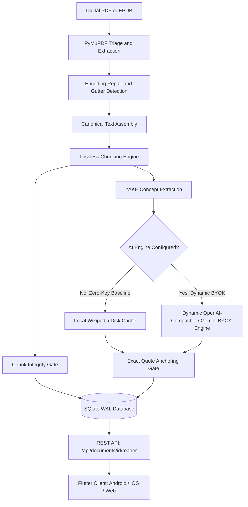

# Athena

Athena is a self-hosted document reader and local backend that converts digital PDFs and EPUBs into contiguous, ordered reading passages interleaved with verified, spoiler-shielded reference cards.

[](https://github.com/praveene3127/Athena/actions/workflows/build.yml)
[](LICENSE)

<!--
DEMO PLACEHOLDER:
Capture a 5-second screen recording showing the vertical reading feed in the mobile client:
1. Smooth scroll through 2 consecutive reading chunks.
2. An inline context card with a spoiler bar: "||reveal||".
3. Tap on the spoiler bar to reveal the empirical finding.
Save as demo.gif or asciinema recording and link here.
-->

## Why this exists

Reading technical books and academic papers on mobile screens is frustrating. Standard PDF readers render fixed two-column desktop layouts that force constant horizontal panning, manual zooming, and squinting. When readers turn to LLM summarizers to bypass the layout friction, they encounter a worse problem: language models discard footnotes, drop critical nuance, and hallucinate historical or empirical assertions.

Athena separates document layout from document text. The backend parses font geometries, repairs broken ligatures, and reconstructs reading order across columns. It slices the canonical text into a single vertical scroll stream without altering, paraphrasing, or removing a single word. Between paragraphs, Athena injects factual context cards retrieved from local Wikipedia caches or verified LLMs. Every claim on a context card anchors directly to an exact substring in the surrounding passage.

| Characteristic | Fixed PDF Viewers (Acrobat, Preview) | AI Summarizers (NotebookLM, ChatPDF) | Athena |
|---|---|---|---|
| Text fidelity | Full visual fidelity, fixed page layout | Paraphrased or summarized (lossy) | Verbatim source text (`"".join(chunks) == text`) |
| Mobile reading | Requires manual zooming and panning | Chat feed without linear document progression | Continuous single-column vertical feed |
| Context mechanism | None; reader leaves app to search | Unbounded generative chat (hallucination risk) | Grounded cards anchored to exact passage quotes |
| Offline execution | Fully local | Cloud dependent | Fully local (local SQLite, FastEmbed ONNX, cached Wikipedia) |
| API keys | None required | Account or paid tier required | Zero-key baseline (verbatim Wikipedia fallback) |

### Non-goals and limitations

Athena makes specific design trade-offs:
- Scanned documents or image-only PDFs: Athena requires a readable digital text layer. It does not run OCR over historical scans or photographed books.
- Summarization or document compression: Athena does not summarize chapters or generate study outlines. If you do not want to read the book, use a standard conversational LLM instead.
- Multi-tenant cloud service: Athena is a local-first system intended to run on your workstation, home server, or local network over USB reverse tunneling and LAN. It contains no authentication, user ACLs, or cloud synchronization.

## Repository structure

```text
Athena/
├── app/                  # Flutter cross-platform client (iOS, Android, Web)
│   ├── lib/
│   │   ├── core/         # Routing, themes, offline mode, internet access gating
│   │   ├── features/     # Feature-first modules (library, reader, settings)
│   │   └── main.dart     # Application entrypoint
│   └── test/             # Flutter unit & widget tests
├── backend/              # FastAPI document processing engine
│   ├── app/
│   │   ├── main.py       # FastAPI application entry point
│   │   ├── routers/      # API endpoints (documents, ask, settings)
│   │   └── services/     # Extraction, chunking, and edge AI
│   │       ├── edge/     # Modular edge AI: hygiene, bouncer, novelty
│   │       └── edge_ai.py# Backwards-compatible service facade
│   └── tests/            # Pytest test suite (49 tests)
├── docs/                 # Architecture records and design guidelines
│   ├── DECISIONS.md      # Architecture Decision Records (ADRs)
│   └── DESIGN.md         # Design system tokens and anti-slop rules
├── scripts/              # Automated verification and release gates
│   └── verify_release.py # 6-gate zero-regression release verification
├── run_athena.py         # Unified supervisor (backend + web forwarder)
├── start_athena.bat      # Windows 1-click launcher
└── README.md
```

## Quick start

### Prerequisites

- Python 3.12 or newer (tested on Python 3.12.10)
- SQLite 3
- Git
- (Optional) Flutter SDK 3.24+ if building the mobile or web client from source
- (Optional) Android SDK and `adb` for USB reverse port forwarding

### Installation

Clone the repository and set up a Python virtual environment:

```bash
git clone https://github.com/praveene3127/Athena.git
cd Athena
python -m venv .venv
```

Activate the virtual environment:

```bash
# Windows
.venv\Scripts\activate

# Linux / macOS
source .venv/bin/activate
```

Install backend dependencies:

```bash
pip install -r backend/requirements.txt
```

### Launching services

Run Athena using the exact 1-line commands below:

```bash
# 1. Launch FastAPI backend (:8000)
python -m uvicorn app.main:app --app-dir backend --host 127.0.0.1 --port 8000

# 2. Launch Web Reader on port 8080 (:8080)
python tools/port_8080_forwarder.py

# Alternatively, launch the unified supervisor (backend, web reader, and USB adb reverse):
python run_athena.py
```

### Smoke test

Verify the backend is healthy:

```bash
curl http://127.0.0.1:8000/api/health
```

Expected output:

```json
{
  "status": "ok",
  "database": "reachable",
  "model_status": "ready",
  "llm_configured": false
}
```

Ingest the bundled sample document to verify the chunking and card pipeline:

```bash
curl -X POST http://127.0.0.1:8000/api/documents/sample
```

Expected output:

```json
{
  "document_id": "8f3b2a1c4e5d6a7b"
}
```

## Usage and examples

### Ingest a document

Upload a PDF or EPUB to the background processing worker:

```bash
curl -X POST http://127.0.0.1:8000/api/documents/upload \
  -F "file=@path/to/book.pdf"
```

Expected output:

```json
{
  "document_id": "8f3b2a1c4e5d6a7b",
  "status": "queued",
  "filename": "book.pdf"
}
```

### Poll ingestion status

Track processing stages across page extraction, cleaning, chunking, and concept lookup:

```bash
curl http://127.0.0.1:8000/api/documents/8f3b2a1c4e5d6a7b/status
```

Expected output:

```json
{
  "id": "8f3b2a1c4e5d6a7b",
  "status": "ready",
  "stage": "done",
  "stage_label": "Ready",
  "current_page": 240,
  "total_pages": 240,
  "percent": 100
}
```

### Read the structured feed

Fetch the verified reading items. The response contains contiguous chunks interleaved with grounded context cards:

```bash
curl http://127.0.0.1:8000/api/documents/8f3b2a1c4e5d6a7b/reader
```

Expected output:

```json
{
  "document": {
    "id": "8f3b2a1c4e5d6a7b",
    "title": "The Structure of Scientific Revolutions",
    "page_count": 210,
    "integrity": {
      "verified": true,
      "chunk_count": 142
    }
  },
  "items": [
    {
      "type": "reading_chunk",
      "id": "chunk_001",
      "sequence": 1,
      "text": "History, if viewed as a repository for more than anecdote...",
      "page_reference": "Page 1"
    },
    {
      "type": "context_card",
      "id": "card_001",
      "insert_after": "chunk_001",
      "card_type": "empirical_study",
      "title": "Historiography of Science",
      "body": "Traditional accounts treat scientific progress as linear accumulation. Kuhn argued that ||anomalies accumulate until normal science enters crisis||.",
      "exact_quote": "repository for more than anecdote"
    }
  ]
}
```

### Connect an Android device over USB

Connect your phone with USB debugging enabled. Forward the local port:

```bash
adb reverse tcp:8000 tcp:8000
```

Install the pre-compiled Android release build directly from the repository:

```bash
adb install releases/athena-release.apk
```

The mobile app accesses the local backend at `http://localhost:8000` through the USB bridge without exposing ports to your Wi-Fi network.

## Architecture



### Pipeline stages

1. Ingestion and triage: The PDF is checked for the `%PDF-` file signature bytes and written to disk using streaming buffers. PyMuPDF inspects font sizes, weights, and bounding boxes to detect gutters and multi-column divisions.
2. Canonical text assembly: Extracted character spans undergo CP-1252 normalization, C1 control code repair, and vocabulary-aware de-hyphenation.
3. Lossless chunking: The chunker slices character spans by offset indices (`canonical_text[start:end]`). Headings are bound to starting paragraphs, and long sections are split at guarded sentence boundaries.
4. Concept identification: Key terms are extracted using YAKE and ranked against the document vocabulary.
5. Context grounding: Concepts query the local Wikipedia cache in `data/cache/wiki/`. If an AI engine is configured, it synthesizes an explanatory context card with interactive spoiler syntax (`||hidden text||`). The backend verifies that `card.exact_quote` exists as an exact substring of the target chunk.
6. Storage and delivery: State is stored in SQLite using Write-Ahead Logging (`PRAGMA journal_mode=WAL; PRAGMA busy_timeout=5000;`). The Flutter client consumes the feed through a single ordered list.

### Dynamic BYOK intelligence engine

Athena has no required or static API providers. It does not bundle proprietary cloud models or enforce vendor lock-in. The AI layer is entirely decoupled through a dynamic Bring-Your-Own-Key (BYOK) architecture:

- Zero-key baseline: Athena operates completely offline out of the box. Key terms are identified via YAKE and grounded against the local disk-cached Wikipedia corpus (`data/cache/wiki/`). No external network requests, accounts, or API keys are required to process or read documents.
- Any OpenAI-compatible endpoint: When AI enrichment is desired, Athena connects to any OpenAI-compatible base URL and API key. This supports fully self-hosted local engines (Ollama, vLLM, LM Studio, LocalAI) as well as remote cloud endpoints and Google Gemini.
- Zero static model lists: Models are never hardcoded. When an endpoint is configured, Athena queries the provider's live model catalog API (`POST /api/settings/fetch-models`) to discover available models in real time, or accepts any custom model name.
- Dual automatic failover: Configure a primary engine and an optional fallback backup engine. If the primary engine triggers a rate limit (HTTP 429), quota exhaustion, or timeout, requests route to the backup engine automatically.
- Runtime database persistence: AI credentials and endpoints are configured directly in the app interface or through `/api/settings/ai-config` and saved in the local SQLite `ai_settings` table. No backend server restarts or static configuration file changes are required.

### Core invariants

Athena enforces two non-negotiable invariants tested on every commit:
- Lossless Chunking: Recombining all chunk strings must reproduce the canonical text exactly:
  ```python
  "".join(chunk["raw_text"] for chunk in chunks) == canonical_text
  ```
- Exact-Quote Anchoring: Every generated context card must anchor to a verbatim substring in its target chunk:
  ```python
  assert card["exact_quote"] in target_chunk["raw_text"]
  ```

## Configuration reference

Server host, storage paths, and ingestion limits are configured in `backend/.env`:

| Variable | Type | Default | Description |
|---|---|---|---|
| `HOST` | string | `127.0.0.1` | Network interface for the Uvicorn server |
| `PORT` | int | `8000` | HTTP port for the FastAPI backend |
| `DATA_DIR` | path | `data` | Storage directory for uploads, SQLite database, and disk caches |
| `LOG_LEVEL` | string | `INFO` | Logging verbosity (`DEBUG`, `INFO`, `WARNING`, `ERROR`) |
| `MAX_UPLOAD_SIZE_BYTES` | int | `524288000` | Maximum file upload size in bytes (500 MB) |
| `MAX_PAGE_COUNT` | int | `3000` | Maximum allowable pages in a single document |
| `WIKI_CONTACT` | string | `athena-reader@example.com` | User-Agent contact email sent with Wikipedia REST requests |
| `VIBE_CHECK_TIMEOUT_S` | float | `4.5` | Timeout in seconds for document preview inference |

AI engine credentials are configured dynamically in the app UI via Settings (persisted to SQLite), or optionally initialized through `.env` fallback seeds (`LLM_API_KEY`, `LLM_BASE_URL`, `LLM_MODEL`, `GEMINI_API_KEY_PRIMARY`) for headless server environments.

## Development and testing

Run the full test suite and static analysis:

```bash
# Backend pytest suite (49 tests)
pytest backend/tests -v

# Flutter static analysis and widget tests
cd app && flutter analyze lib && flutter test && cd ..

# Full 6-gate production verification
python scripts/verify_release.py
```

## License

Athena is licensed under the Apache License, Version 2.0. See the [LICENSE](LICENSE) file for the full license text.
